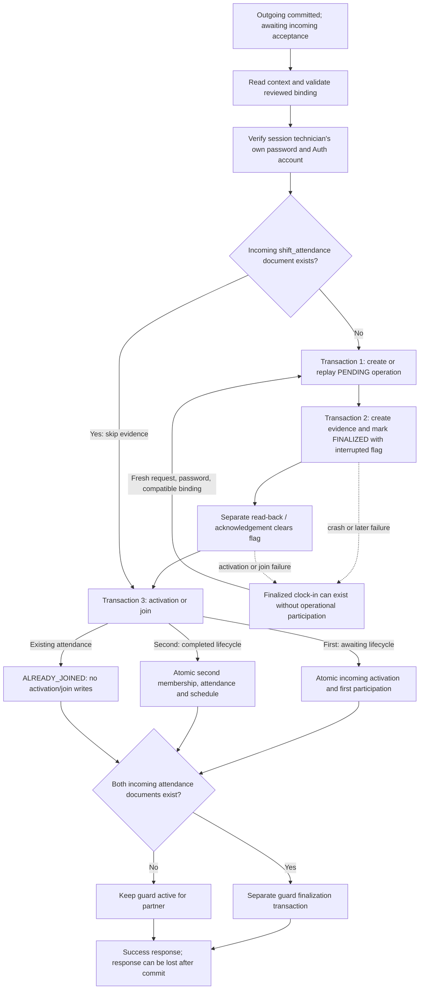

# 09M-R3A — incoming acceptance transaction integrity

Repository: `C:\Users\Jonah\Desktop\KobbyProject\NOC-SHIFTCHANGE`.
Branch verified: `feature/handover-v2-recovery`. Audit date: October 28, 2026.

**Finding:** the current coordinator does not provide atomic acceptance across
attendance evidence and operational participation. A failed first activation or
second join can leave a finalized personal clock-in with no corresponding
participation. Ordinary fresh retries often recover, but recovery is not complete
for every binding, timing or inconsistent-record condition. Evidence finalization
alone must not be presented as proof of a successful activation or join.

This milestone adds tests and this report only. Production behavior, attendance
contracts, R1 tooling, R2 semantics and existing working-tree changes are retained.
No live Firebase access, emulator start/stop/restore, snapshot change or live
handover operation was performed. R3B is a proposal, not implemented work.

## Baseline and source map

The starting tree was already dirty, including the acceptance route, report
Firestore service, notification additions and R1/R2 files. No prior edit was
reverted. A SHA-256 baseline captured 394 existing source, script, test,
documentation and 09M snapshot files before adding the audit files.

| Location | Responsibility |
| --- | --- |
| `src/app/(dashboard)/api/operations/shifts/[shiftId]/handover/v2/accept/route.ts:49` | HTTP coordinator: session/origin/body, reviewed binding, password verification, evidence, activation/join, guard cleanup, response |
| Same route `:98` | Authoritative Auth account pre/post-check and personal password reauthentication on every eligible request, including retries |
| Same route `:134` and `:165` | Captures an event clock, begins an evidence operation, recaptures the clock, finalizes evidence |
| Same route `:184` | Calls the separate activation/join transaction |
| Same route `:195` | Best-effort deferred guard finalization; notification actioning follows committed acceptance |
| `src/lib/operations/attendance-evidence-firestore.ts:250` | Begin: deterministic pending operation and immutable request digest |
| Same file `:321` | Evidence + finalized operation commit atomically with each other, independently of activation |
| Same file `:450`, `:513` | Resume/read-back acknowledgement; clears the interrupted flag, never activates or joins |
| `src/lib/operations/equal-handover-report-firestore.ts:1804` | Operational activation/join transaction |
| Same file `:1853` | Completed handover: existing-attendance replay or new second-technician join |
| Same file `:1927` | First activation: outgoing completion, incoming shift, participation, schedules, control and receipt |
| Same file `:2119`, `:2281` | Guard finalization and separate attendance-existence resolution check |
| Same file `:2194` | Read-only acceptance context; UID/kind/event key/binding derivation |
| `src/lib/operations/attendance-evidence-domain.ts:617` | Evidence construction, scoped identity, guard, authentication and timing contracts |
| `src/lib/operations/equal-technician-handover-domain.ts:299`, `:927` | Reviewed snapshot projection and activation lifecycle change |
| `src/lib/operations/handover-v2-report-http.ts:161` | Exact acceptance body; password + reviewed binding only |
| `tests/handover-v2-acceptance-emulator.test.mjs:253`, `:467` | Existing service-oriented acceptance and concurrent-first-acceptance tests |

## Current acceptance state diagram



There is no single persisted coordinator operation covering all these steps.
`attendance_evidence_operations_v2.finalized` means evidence finalization, not
operational acceptance completion. `interruptedFinalization` tracks evidence
acknowledgement only, not an incomplete activation.

## Persisted transitions and owners

| Step / authoritative owner | Reads and persisted result |
| --- | --- |
| Context reader | Aggregate, reservation guard, current profile and actor attendance existence. No writes. |
| Auth/password service | External credential verification and account checks. No acceptance receipt or durable password proof is stored by this route. Passwords/tokens are not persisted. |
| Evidence begin transaction | Checks slot/cross-kind evidence and guard binding; creates `attendance_evidence_operations_v2` as `pending` with `requestedAt`. Existing event ID must have exactly the same request digest. |
| Evidence finalization transaction | Re-reads pending operation, active guard and aggregate identity; creates deterministic `attendance_evidence_v2` and marks operation `finalized`, `interruptedFinalization: true`. Does not read activation prerequisites such as current schedules/control or verify current profile eligibility. |
| Evidence acknowledgement | Reads persisted evidence and clears `interruptedFinalization` using a separate operation write. Resume cannot apply an activation or complete a pending operation. |
| First activation transaction | Rechecks reserved incoming actor/profile, active guard, commitment receipt, outgoing/incoming shifts, pairs, memberships, schedules, activation window and control. Writes completed aggregate/outgoing shift, one incoming active shift, first actor membership and `present` legacy attendance, outgoing member endings, schedule updates, transferred control, one deterministic activation receipt, activity stamps and enabled completion outbox entries. Partner attendance is not fabricated. |
| Second join transaction | Validates active shift/control, reserved actor/pair/schedule, active guard, activation receipt and missing member. Creates only that actor's membership/attendance, updates their schedule and activity. Aggregate/activation receipt remain unchanged. No dedicated per-join audit receipt is created here. |
| Existing-attendance replay | In completed lifecycle, attendance **existence** short-circuits detailed attendance/member/evidence validation. Receipt is validated if present but may be null on this branch. No activation/join writes. |
| Guard cleanup | Route checks both attendance documents outside the finalization transaction. Finalizer validates completed aggregate and activation receipt, then records guard completion/history. The finalizer itself does not revalidate both participants' evidence/membership/attendance. |

The operational transaction does **not** read the evidence/operation collections.
Its input contains a server authentication timestamp, not a validated durable
proof/reference tying the operational write to a particular evidence result.
These are trusted server-only primitives; this finding is not evidence of a
public unauthenticated endpoint. The existing HTTP route does require password
reauthentication before calling them.

## Failure-state matrix

`P` = pending operation; `E` = finalized evidence/operation;
`A` = atomic activation/first participation; `J` = atomic second participation.

| Failure/interruption boundary | Possible durable state | Current recovery and limitation |
| --- | --- | --- |
| Before context/password or stale reviewed binding | No acceptance writes | Reload stale review as needed. A valid new request must authenticate. |
| Password fails / Auth account changes | No new acceptance writes | Reauthenticate correctly; accepted-status replay also does not bypass password verification. |
| Password succeeds, before begin | No durable acceptance proof or evidence | New request verifies password again. No unattended resume capability exists. |
| Begin fails before commit | No new operation | Fresh retry can begin. |
| Begin commits, interruption before evidence | `P`, no evidence or participation | Same binding + fresh password can finalize. Resume alone rejects pending. Changed immutable request fields conflict on the same event ID. |
| Evidence transaction fails before commit | `P`, no partial evidence/finalization writes | Fresh compatible retry can finalize. |
| Evidence commits, acknowledgement lost | `E`, interrupted flag may remain true; no participation | Evidence resume can clear the flag; it cannot activate/join. Fresh authenticated coordinator retry may continue. |
| Evidence ack fails / interruption before activation | `E`, no participation | Evidence survives the failed request. Compatible authenticated retry replays original evidence and applies a later operational time. |
| Activation validation/commit fails | `E`; outgoing/control remain unchanged; no partial incoming shift writes | Fix the actual failed prerequisite, then reauthenticate/retry. There is no automatic reconciliation. A permanent eligibility/window failure can leave evidence indefinitely. |
| First activation commits, response/ack lost | `E + A`, potentially unfinished guard cleanup | Retry with current reviewed binding and fresh password returns `ALREADY_JOINED`, without duplicate operational records. |
| Second join validation/commit fails | First `A` remains; second actor has `E` but no `J` | Fresh compatible retry can join. The unjoined actor's guard remains active. |
| Second join commits, response lost before/after guard completion | `E + A + J`; guard may be active or completed | Cleanup can retry. If cleanup changed guard revision, an identical old HTTP body fails 409 before password; reload binding, then authenticate and replay. |
| Guard cleanup fails | Acceptance already committed, guard still active | Route intentionally returns success with `guardFinalized: false`; later accepted-user retry can retry cleanup. |
| Guard/binding changes after `P` or `E` | Old operation is retained | New context can produce a different request digest under the same deterministic event ID; begin rejects 409. Needs deliberate reconciliation, not overwriting the old request. |
| Imported/corrupt attendance doc exists without corresponding member/evidence | Replay may return successful `ALREADY_JOINED` | Current existence shortcut does not detect the inconsistency; automatic guard cleanup also uses attendance existence. This requires pre-existing inconsistent state, not a normal partial commit of the operational transaction. |

## Idempotency, concurrency and clocks

Operation IDs derive from the event ID; the event ID derives from handover,
technician and evidence kind. Evidence slot IDs derive from handover, technician
and kind. Membership and legacy attendance IDs derive from incoming shift and
technician. The activation receipt ID derives from the handover document.
Create-only writes and transaction retries prevent normal duplicate application.

The reviewed aggregate snapshot deliberately excludes lifecycle and `updatedAt`.
Normal first activation changes lifecycle to completed without changing revision,
snapshot hash or the deferred guard. Thus ordinary first activation does not
itself invalidate the partner's operation digest. The changed-guard tests inject
a same-owner revision change; they demonstrate binding-change behavior, not a
claim that normal activation increments that revision.

Both incoming HTTP requests can converge to one activation and one join when
their event times are compatible. There is also a reproducible ordering race:
technician B finalizes evidence first but waits; A authenticates later and
activates; B then reaches JOIN with an earlier timestamp and fails the
`now < activatedAt` gate. B's evidence remains finalized. A fresh retry can join,
but its original evidence clock-in remains earlier than activation. No records
are duplicated, yet the timing/provenance needs explicit interpretation.

The route's `serverAuthenticationTime` is recaptured **after begin**, not precisely
when password verification completed. On the initial attempt, evidence
`eventTime`/`clockIn` and activation receipt `activatedAt`/shift `actualStart` use
that same supplied clock, even if activation executes later. On a retry after
evidence finalization, the original evidence time stays immutable while activation
or join uses the retry's newer clock. Firestore server-timestamp fields such as
`startedAt` exist, but there is no unified per-person receipt linking and naming
password verification time, evidence event time and application commit time.

Every HTTP attempt that reaches application re-verifies the technician's own
password; stale-binding requests may be rejected earlier. Evidence replay is
not permission to omit password verification. The finalized evidence primitive
itself returns stored terminal evidence without rebuilding or re-timing it; its
trusted-coordinator boundary must remain explicit.

An additional existing policy/input gap was reproduced: a confirmed incoming
technician without a standing `not_yet_in` declaration cannot supply a meaningful
late reason after the five-minute grace period. Context supplies null, evidence
construction requires a reason, and the exact HTTP body rejects `lateReason`.
The request can leave a pending operation. Do not invent an absence or reason to
work around this; it needs an explicit product/input decision for R3B or a
separately scoped follow-up.

## Isolated failure-test findings

New files:

- `tests/helpers/acceptance-integrity-fixtures.mjs`: network-free loader and
  disposable in-memory document store with staged atomic writes, read/query
  version conflicts and transaction callback retries; controlled clock,
  Auth/password boundary mocks and failure hooks.
- `tests/incoming-acceptance-integrity.test.mjs`: 30 characterization tests
  invoking the actual, unmodified HTTP coordinator and production evidence,
  activation/join and guard services.

The store has no Firebase SDK/network implementation. Unexpected dependencies
fail closed. No environment variable can redirect it to the live 09M project.
Password verification itself is mocked: tests prove coordinator ordering and
fresh calls, not Firebase credential-provider behavior.

Tests cover all matrix boundaries; first/second/repeated acceptance; simultaneous
different/same actors with conflicts; write-free replay; response loss; pending
and finalized evidence retries; evidence acknowledgement recovery; immutable
event times; earlier-auth/later-join ordering; changed guard request conflicts;
profile eligibility loss; stale review; cleanup failure; inconsistent attendance
existence; the late-reason gap; and the lack of an evidence prerequisite inside
the internal activation primitive.

The initial run failed to parse a missing brace in the new response mock. It was
fixed without modifying production code. The next run passed all 28 tests then
present. Two timing/pending tests were subsequently added for the final run.
Final suite/lint results and preservation evidence are recorded below.
Tests labeled `DEFECT` pass by asserting a reproducible
current defect; passing characterization tests do not mean the defect is fixed.

This model is not a substitute for Firestore SDK contention, lock/deadline,
network or emulator testing. Its query version conflicts are conservative and
its timestamp class approximates the SDK. An isolated emulator failure suite is
required during R3B validation; none was started or restored during R3A.

## Recovery design comparison

| Approach | Assessment |
| --- | --- |
| Single atomic application transaction after fresh external password verification | **Recommended.** Evidence finalization, operational membership/attendance, activation or join and an application receipt can share one Firestore transaction in the existing database. No finalized-success evidence is published before the matching operational write. Authentication stays outside retryable callbacks. Requires transaction-composable evidence helpers and application-bound replay validation. |
| Durable staged verified intents + reconciler | Viable for asynchronous/large workflows, but a stronger protocol and worker lifecycle are required. Persist an intent as explicitly non-attendance, apply operational writes and evidence together, then acknowledge. Authentication proof must be subject-bound, bounded and single-use; expiration/revocation must require fresh personal authentication. A finalized evidence record cannot double as a verified intent or recovery authorization. |
| Compensate by deleting/aborting already finalized evidence | Reject. It destroys or rewrites authenticated history, and races with a successful but unacknowledged operational commit. Current abort correctly only permits pending operations. |
| Read-before-write check or automatic retry of today's split services | Insufficient. Separate checks cannot close the commit gap, establish per-person application proof, or resolve changed bindings safely. |

Safest within the current architecture: one atomic **application** transaction,
optionally preceded by a non-attendance pending intent if operationally needed.
It cannot make the external Auth service atomic with Firestore; existing account
pre/post checks and in-transaction profile eligibility must remain, and the
approved authentication freshness/revocation policy must be explicit.

### Proposed state machine and invariants for R3B

```mermaid
stateDiagram-v2
  [*] --> AwaitingPersonalAuthentication
  AwaitingPersonalAuthentication --> VerifiedInMemory: own password + account checks
  VerifiedInMemory --> AppliedActivation: atomic evidence + first participation + activation + receipt
  VerifiedInMemory --> AppliedJoin: atomic evidence + second participation + join receipt
  VerifiedInMemory --> RetryRequired: no application commit
  RetryRequired --> AwaitingPersonalAuthentication
  AppliedActivation --> Acknowledged
  AppliedJoin --> Acknowledged
  AppliedActivation --> AppliedActivation: fresh authenticated replay; validate receipt and records
  AppliedJoin --> AppliedJoin: fresh authenticated replay; validate receipt and records
  LegacyUnappliedEvidence --> ReviewRequired
  ReviewRequired --> AwaitingPersonalAuthentication: explicit authorized recovery, current binding
```



1. A stable business key identifies one handover/technician application,
   independently of changing reviewed binding fields. Keep each authentication
   attempt/request binding immutable; changed bindings are new reviewed attempts,
   not mutation of an existing evidence operation or bypass of fencing.
2. Verify password and authoritative UID outside the transaction. Capture a
   clearly named `passwordVerifiedAt`; never store credentials/tokens. Pass a
   trusted subject-bound in-process proof into the application service. A worker
   design would additionally need a deliberately specified durable proof/expiry.
3. In one transaction, re-read profile, reservation/guard, lifecycle, schedules,
   control, applicable evidence/operation and per-person application receipt.
   Validate existing scoped member/attendance, not just document existence.
4. First actor atomically activates exactly once, creates only their participation,
   finalizes their evidence/operation and creates their application receipt.
   The contending actor's Firestore callback retry must derive JOIN from current
   state; it must not repeat an Auth request inside that callback.
5. Second actor atomically joins once and creates a per-person application/join
   receipt. Replays validate the same evidence/receipt/member/attendance/shift
   relationships and return the original committed result without re-timing.
6. Keep separate named clocks: password verification, immutable evidence event,
   and actual application/activation commit. Use a commit server timestamp in
   the new application receipt; preserve existing receipt/time meanings for
   historical documents. Define operational participation start separately from
   an earlier failed attempt's authentication; do not silently turn that earlier
   time into hours worked. New-operation request/event ordering must still satisfy
   the existing domain validator rather than backdating or clamping timestamps.
7. Keep the guard active until both required personal applications are proven.
   Revalidate that condition inside automatic guard completion, using scoped
   receipts/member/attendance. Cleanup acknowledgement must not turn a committed
   application into failure. Keep an explicit operator-only exceptional path if
   the product needs closure for a partner who never arrives.
8. Success is an application receipt plus consistent operational state; evidence
   alone, a pending intent or `interruptedFinalization: false` is insufficient.
   Update relevant consumers to honor this distinction for new protocol records.

### Legacy recovery and compatibility

- Do not rewrite existing completed handovers, frozen reports, report bindings,
  digests, event history, authenticated evidence or original timestamps.
- Version the new application/recovery contract, preferably in a dedicated
  acceptance-operation/receipt collection. Preserve deterministic legacy IDs;
  do not create competing evidence for the same handover/person/kind slot.
- A historical completed handover without new receipts needs a read-only legacy
  compatibility classification. Validate existing receipt, scoped attendance and
  membership/control as applicable; do not fabricate missing personal evidence
  or automatically reconstruct it for old completed history.
- Inventory legacy finalized evidence without matching operational application.
  Preserve it as a historical authenticated attempt. Add a separate reconciliation
  classification/reference if needed, so it is not counted as applied shift
  attendance. No such inventory or annotation was written to live 09M in R3A.
- Recover an unapplied legacy attempt only through a fresh personally authenticated,
  currently authorized request and an explicit approved binding/recovery rule.
  An atomic application receipt can reference the preserved old evidence and the
  new authenticated attempt, keeping their clocks distinct. If the old evidence
  cannot satisfy the approved contract, stop for review rather than re-time it,
  delete it, infer attendance or reuse an expired credential event.
- Existing consumers such as `attendanceEvidenceCountsAsClockIn`, report attendance
  reduction and attendance-state reads must be audited for protocol-aware
  application status. Leave frozen report bytes unchanged; new semantics enter
  only the intended preparation/read workflows.
- Receipt schema additions, indexed reads, transaction size/write limits,
  notification outbox idempotency, legacy snapshots and late-reason policy all
  require compatibility tests. R1 manifests must never be backfilled or modified.

## Required production changes and R3B implementation plan

1. **Approve the invariants and policy choices:** stable application key,
   authentication freshness, separate clock meanings, legacy orphan treatment,
   guard closure and ordinary late-arrival reason input. Specify expected user
   outcomes for recovery conflicts; do not weaken password verification.
2. **Introduce a versioned per-person application receipt/state domain**, with
   deterministic identity and validated references to handover, subject, evidence,
   membership/attendance, outcome and authentication/application clocks.
3. **Refactor `attendance-evidence-firestore.ts` into transaction-composable
   reads/validation/writes** while retaining existing external primitives for
   other callers. Keep pure attendance-domain validation authoritative. Do not
   use nested transactions or an independent early finalization in acceptance.
4. **Refactor `acceptEqualHandoverIncomingV2` in
   `equal-handover-report-firestore.ts`** to atomically finalize/apply evidence and
   first activation or second join with the per-person receipt. Harden replay,
   record consistency and in-transaction guard completion conditions.
5. **Update the acceptance HTTP coordinator** to call that application boundary
   after fresh password checks. Keep client-supplied identity/kind/time forbidden;
   handle lost acknowledgements as lookup/replay of the committed application.
6. **Add explicit legacy classification/recovery support and consumer checks.**
   Separate a read-only dry-run inventory from any approved migration. Never
   silently repair a malformed attendance/member record or change an old report.
7. **Run the regression/failure suite below**, then isolated emulator contention
   and network/acknowledgement tests, TypeScript and targeted lint. Review before
   any separately authorized live rehearsal, migration or deployment.

Required R3B tests extend these characterization tests into invariant assertions:

- Fail before and after every atomic write/commit/ack boundary: no finalized
  successful evidence without matching applied participation.
- Concurrent first actors and duplicate same-actor requests; exactly one shift,
  first receipt, personal evidence slot and per-person application.
- Second join, both accepted-user replays after guard completion, lost responses
  with stale binding, and failed best-effort cleanup.
- Earlier-auth/later-join race and retry clocks; preserve authenticated-at and
  committed-at separately without fabricating personal work duration.
- Wrong password, disabled/changed Auth account, profile changes, UID mismatch,
  stale proof, guard/epoch change, operation-request conflict and lifecycle closure.
- Missing/malformed/foreign attendance/member/evidence/receipts: explicit conflict,
  never existence-only success or automatic inferred attendance.
- Legacy completed handover with/without personal evidence; finalized orphan,
  pending/aborted operations, interrupted evidence acknowledgement, deliberate
  recovery with new authentication, and no mutation of historical artifacts.
- Ordinary late reason and declared `not_yet_in` late acceptance, with no
  fabricated absence/reason and unchanged supported absence requirements.
- Existing R1 snapshot verification, R2 reporting semantics/digest drift,
  frozen-report immutability, all operational-event provenance and notifications.

## Final validation and preservation

Final command:

```text
node --test tests/incoming-acceptance-integrity.test.mjs tests/attendance-evidence-domain.test.mjs tests/handover-report-attendance.test.mjs
```

**71 passed, 0 failed, 0 skipped**, including all 30 new characterization tests,
16 existing attendance-evidence domain tests and 25 R2 report tests.
Log: `.demo/09m-r3a-tests-final.log`. Targeted ESLint passed for both new test
files with exit code 0 and no diagnostics; log:
`.demo/09m-r3a-lint-final.log`. `git diff --check` passed (existing line-ending
conversion warnings only).
No production TypeScript file changed; this milestone executed the JavaScript
fixtures against transpiled production sources rather than claiming a new
full-project TypeScript check.

At `2026-10-28T06:16:06.197Z`, all **394 pre-audit files** matched their SHA-256
baseline with zero changes. This includes all existing production code,
attendance contracts, R1/R2 scripts/source/tests/docs, and all 31 existing 09M
snapshot-root files. Evidence: `.demo/09m-r3a-preservation.json` and
`.demo/09m-r3a-protected-baseline.json`.

Only the two new audit test files and this report were added outside ignored
local validation artifacts. No production coordinator/domain changes, live
Firestore requests/writes, emulator operations, live handover transitions,
snapshot/manifest modifications, Git commit/push/reset or deployment occurred.
No production implementation changes are authorized by this audit report.
