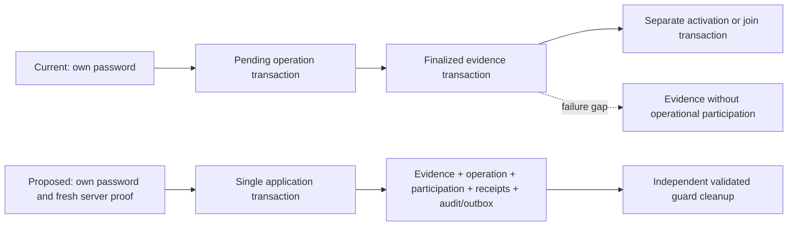
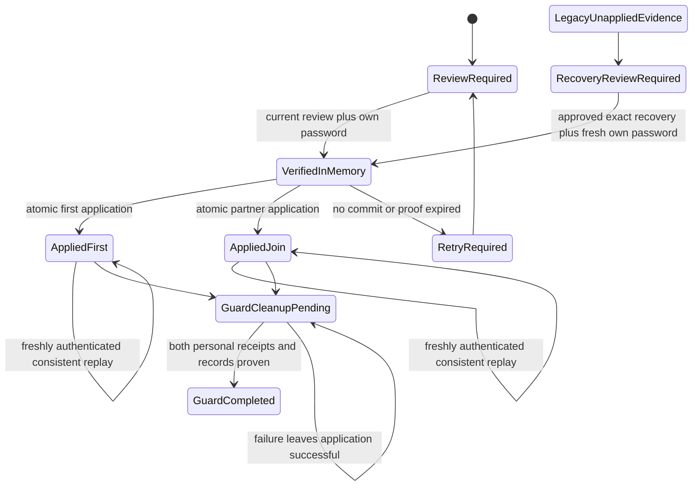

# 09M-R3B.1 — atomic incoming acceptance design

Status: **design proposal for approval; no implementation authorization**.
Repository: `C:\Users\Jonah\Desktop\KobbyProject\NOC-SHIFTCHANGE`.
Branch: `feature/handover-v2-recovery`, HEAD `c170353` (verified 2026-10-28).
Target project: `demo-shiftchange-v2-09m` (app 3130, Auth 9399, Firestore 8380).
Technical baseline: the completed R3A audit and its 30 characterization tests.

## 0. Baseline verification and scope guard

Verified on 2026-10-28 before this document was revised:

- Branch `feature/handover-v2-recovery`, HEAD `c1703530437ff4e45010dde4f920597fe7684d9f`
  (`feat(handover): drive v2 activation from incoming password acceptance (TECH-HO-RECOVERY-08)`).
  The presentation UAT HEAD is not treated as the complete R1/R2/R3A baseline.
- The working tree is deliberately dirty: **104** `git status --short` entries,
  identical to the recorded R3B.1 start except for this new design document.
  R1, R2, 09L, 09M and other pre-existing changes are preserved, not reverted.
- R3A artifacts are present and unchanged: `docs/09M-R3A-ACCEPTANCE-INTEGRITY-AUDIT.md`
  (28,699 bytes), `tests/incoming-acceptance-integrity.test.mjs` (16,319 bytes) and
  `tests/helpers/acceptance-integrity-fixtures.mjs` (13,045 bytes). The audit recorded
  30 characterization tests and a 71-test final baseline; this pass does not re-run
  them and does not claim a new implementation test.
- The pre-design hash baseline `.demo/09m-r3b1-baseline.json` contains **397**
  source, script, test, documentation and snapshot files. All 397 re-hashed with
  zero changes before this document edit.
- This pass re-read the current acceptance coordinator, evidence domain/service,
  activation/join transaction, guard completion, notification writer, R1 verifier,
  R2 attendance reduction and frozen-report binding. Two corrections were made:
  the Firestore transaction limit is **500 writes per transaction** (not merely a
  per-document transform budget), and the evidence domain has **no late-reason
  length cap**; the HTTP boundary must impose one (D4).

Protection constraints for this milestone:

- No Firebase endpoint, emulator, UAT app, snapshot export or protected shift was
  read or written. The presentation stack (3100/9099/8080), 09D (3110/9199/8180),
  09L (3120/9299/8280) and 09M (3130/9399/8380) remain untouched.
- `VnSQOixJy8LuB6AucyUd` and `WfKvXM6ZamF8P4n1lWlA` were not accessed.
- No production code, `package-lock.json`, snapshot pointer, export or manifest was
  modified. This milestone changes documentation only.

## 1. Executive design decision

Use one Firestore **application transaction**, after personal password verification
outside the transaction. It atomically commits the subject's personal evidence,
finalized operation, operational participation, deterministic per-person receipt,
and required audit/outbox records. The same transaction derives FIRST_ACTIVATION
or SUBSEQUENT_JOIN from current authoritative state. Neither pair position has
priority. A missing receipt or inconsistent record is never successful replay.

Do not separately persist finalized incoming evidence before applying attendance.
Do not use an attendance document's existence as proof of acceptance. Preserve
all existing report, confirmation, commitment, absence and lineage gates; validate
their stored bindings rather than revising the outgoing report during acceptance.

Proposed new receipt: `incoming_acceptance_applications_v1`. Existing V2 evidence,
legacy attendance and global activation receipt remain supported. The proposal
requires an explicitly approved timing-contract clarification for **new atomic
acceptance events**, described in section 5. Historical event meanings are not
changed. Legacy orphan recovery is a separate, opt-in protocol, not automatic
repair and not a reason to weaken the clean atomic path.

Guard completion remains a separately retryable cleanup transaction after both
personal applications are proven. External Auth, push delivery and HTTP responses
cannot be made atomic with Firestore; the receipt is the durable application
result when their acknowledgements are lost.

## 2. Exact current contract and architecture

The starting working tree is dirty, including existing acceptance/notification
changes and R1/R2/R3A artifacts. This milestone preserves them. A pre-design hash
baseline covers 397 existing source/script/test/doc/snapshot files
(re-verified: 397/397 unchanged on 2026-10-28). No live Firebase read was used to
establish this contract.

### Source map

| Current source | Contract inspected |
| --- | --- |
| `src/app/(dashboard)/api/operations/shifts/[shiftId]/handover/v2/accept/route.ts:49` | Session, origin, exact body, context, reviewed binding, own-password verification, separate evidence and application calls |
| Same route `:98`, `:134`, `:165`, `:184`, `:195` | Auth account checks; recaptured clock after begin; evidence finalization; activation/join; best-effort guard cleanup |
| `src/lib/auth/password-reauthentication.ts` | Authoritative email/UID; exact password passed unchanged; Identity Toolkit `localId` must equal session UID; tokens discarded; fixed safe errors |
| `src/lib/operations/attendance-evidence-domain.ts:221`, `:617` | IDs, request digest, identity/guard/kind/authentication/time validators |
| `src/lib/operations/attendance-evidence-firestore.ts:250`, `:321`, `:450` | Pending operation; independent evidence finalization; acknowledgement-only resume |
| `src/lib/operations/equal-handover-report-firestore.ts:1804`, `:1853`, `:1927` | Operational application; completed-lifecycle replay/join; first activation |
| Same file `:2119`, `:2194`, `:2281` | Deferred guard finalization, authoritative context, attendance-existence resolution |
| `src/lib/operations/equal-technician-handover-domain.ts:299`, `:927` | Snapshot excludes lifecycle/updatedAt; activation changes lifecycle without replacing reviewed report |
| `src/lib/operations/handover-reservation-guard-domain.ts` and `handover-reservation-guard.ts` | V1/V2 shared ownership, active/completed/cancelled states, revision/fencing and terminal evidence |
| `src/lib/operations/shift-join-domain.ts:381`, `attendance-read-domain.ts` | Scoped non-provisional legacy `present`; null clocks; strict read validation |
| `src/lib/operations/shift-activation-window.ts` | First activation from 15 minutes before start through min(start + 60 minutes, end), inclusive |
| `src/lib/notifications/notification-hooks.ts`, `notification-outbox.ts`, `notification-domain.ts` | Pure deterministic intent builders; transactionally written notification/outbox; current writer uses `set` |
| `src/lib/operations/handover-report-attendance.ts`, `handover-report-attendance-view.ts` | R2 separates reporting, personal clocks and unknown hours; incoming not-yet-due; historical notice grouping |
| `scripts/snapshots/09m-snapshots.mjs` | R1 validates immutable manifests/export hashes and first activation evidence; milestone does not mean both incoming arrivals |
| `docs/09M-R3A-ACCEPTANCE-INTEGRITY-AUDIT.md`, `tests/incoming-acceptance-integrity.test.mjs` | Failure matrix and executable current-behavior baseline |

### Authoritative documents and IDs

`H` = reservation fingerprint `handoverId`; `D = handover_v2_<outgoingShiftId>`;
`I` = reserved incoming shift; `U` = session-derived incoming technician UID.
All hashes below use canonical, namespaced material, not string concatenation of
ambiguous unescaped IDs. Keep current hash functions for existing documents.

| Collection | Identity and authority |
| --- | --- |
| `users` | `U`; current role/status/forced-password/operation eligibility |
| `equal_handovers_v2` | `D`; identity, reservation, report binding, confirmations, absences, revision and lifecycle |
| `handover_reservation_guards` | `guard_<outgoingShiftId>`; shared protocol owner, reservation, lineage, guard revision, fencing epoch, terminal reference |
| `handover_reservation_guard_history` | Existing guard history builder's IDs; preserve helper-generated identities and immutable provenance |
| `handovers` | Legacy handover ID from existing guard reader; coexistence/ownership evidence, never a V2 application destination |
| `handover_report_preparations_v2` | `preparation_<H>`; reviewed revision/content digest/history; no acceptance writes |
| `handover_reports_v2` | Bound `report_v2_<uuid>`; immutable content/digest/binding; no acceptance writes |
| `shifts` | Outgoing and `I`; authoritative lifecycle and actual start/end |
| `operational_shift_control` | `global`; unique operational slot and generation |
| `technician_pairs`, `technician_pair_memberships` | Pair ID and technician UID respectively; current reserved roster relationships |
| `technician_schedules` | Technician UID; exact scheduled or active participation entry |
| `shift_members`, `shift_attendance` | `<shiftId>_<UID>`; operational membership and reporting attendance, not proof of password by themselves |
| `attendance_evidence_operations_v2` | `att2_op_<hash(eventId)>`; immutable request digest, pending/finalized/aborted and acknowledgement state |
| `attendance_evidence_v2` | `att2_ev_<slot hash>`; slot hashes `(H,U,kind)`; immutable personal/attested event provenance |
| `audit_logs` | Existing `handover-commit-v2-<hash(D)>` and `handover-activation-v2-<hash(D)>`; deterministic namespace-specific receipt material and hashes |
| `notifications`, `notification_outbox` | Existing `notificationDocumentId` / `outboxDocumentId` of event-kind/event/recipient idempotency key; preserve exact builders |
| `shift_operation_events`, `shift_operation_heads`, `handover_report_corrections` | Existing operational provenance/corrections; read-only to acceptance, never rewritten |

Current acceptance event ID hashes `(H,U,kind)` with the `acceptance_v2_` prefix.
The operation request digest also includes reviewed aggregate/guard fields. Thus
a changed request under the same deterministic event can conflict. The existing
cross-kind conflict check specifically prevents contradictory outgoing personal
and attested departure; it is not a per-person acceptance receipt.

Current lifecycle: collecting confirmations -> awaiting incoming acceptance on
outgoing commit -> completed on first activation. The second technician joins
the already active incoming shift; completed does not mean both arrived. The
guard stays active until deferred completion. Cancelled/superseded reservations
cannot accept. Incoming late acceptance uses the standing `not_yet_in` declaration
to select kind and preserve its provenance, without changing that declaration.

Current evidence and operational writes each have internal atomicity, but not
atomicity with each other. Existing-attendance replay short-circuits member and
evidence checks. Activation requires commitment receipt existence, while this
design additionally requires full receipt integrity/binding validation. Ordinary
activation preserves snapshot hash/revision and guard, so it does not inherently
invalidate the other actor's request. R3A's changed-guard case is conditional.



## 3. Atomic transaction read/write inventory

### Coordinator boundary

1. Validate feature gate, session, active account prerequisites, same origin,
   path and exact body. Resolve current reserved incoming authority and review
   binding read-only. Reject stale review before exchanging credentials.
2. Capture `requestAcceptedAt`; verify the session subject's own password via the
   existing helper and authoritative Auth email. Record `passwordVerifiedAt`
   immediately after successful UID verification; recheck the Auth account.
3. Build a non-serializable, request-local trusted proof containing UID, review
   fingerprint, reason digest, verification clock and monotonic freshness clock.
   This object never comes from a body, URL, cookie field supplied as an override,
   persisted bearer token or previous finalized evidence. Do not log it raw.
4. Call one server-only application service. No separate begin/finalize service
   call in this new acceptance path. Other evidence callers retain their existing
   primitives. A late-reason validation error creates no pending operation.

### Read phase — complete before the first queued write

| Read set | First activation | Subsequent join / replay |
| --- | --- | --- |
| Actor profile, aggregate, guard and legacy guard context | Validate reserved active incoming UID, owner, lineage, revision/fence, committed lifecycle | Same; replay allows matching completed guard, not moved ownership |
| Application protocol enrollment, actor receipt and other actor receipt | Native protocol or explicitly approved legacy recovery; actor receipt absent for a new write | Validate actor receipt first if present; other receipt/activation link proves current origin |
| Frozen report, outgoing commitment receipt and activation receipt | Validate report content digest/binding and commitment hash/identity; activation receipt absent | Validate bound historical report/commitment and existing activation receipt; do not regenerate report |
| Evidence operation, subject evidence slot, relevant other-kind slots | Prove vacant native slot or approved pending/recovery case; scoped operation identity/digest | Validate own receipt evidence or select explicit conflict; never presence-only replay |
| Incoming/outgoing shifts and global control | Outgoing owns pending slot; incoming absent; schedules/window eligible | Incoming active and owns slot for NEW JOIN; historical replay may be completed later, as described below |
| Pairs, memberships and schedules | Validate both reserved pairs and all current outgoing members; outgoing and incoming schedule entries | Validate current actor's pair/scheduled entry for new JOIN; existing applied participation on replay |
| All incoming attendance/member documents | New actor absent; no fabricated partner records | Validate each present record with its receipt; mismatched halves are a conflict |
| Approval/reconciliation record, if explicit recovery | Exact subject, reservation, observed legacy evidence hash and allowed current binding | Same; no wildcard migration authority |
| Deterministic audit/notification/outbox target documents | Read all targets to plan create-only/idempotent writes | Preserve existing delivery/read/action state; replay plans no duplicate intents |

Pure helpers validate all identity and digest relationships and produce a write
plan. Derive FIRST_ACTIVATION or SUBSEQUENT_JOIN inside each callback from the
re-read state. Recheck proof freshness, reason requirements and clock order after
reads and before staging. No Auth network call, FCM call, HTTP response, global
state mutation or acknowledgement read occurs inside the retryable callback.

### Write phase — one successful commit or no application writes

| Write | FIRST_ACTIVATION | SUBSEQUENT_JOIN |
| --- | --- | --- |
| Subject V2 personal evidence + operation | Create evidence and finalized operation together; no durable standalone pending state for clean native requests | Same, only for joining subject |
| `equal_handovers_v2/D` | Existing domain transition to completed; retain report, confirmations and absences | No lifecycle rewrite |
| Outgoing shift and current members | Complete outgoing and end existing memberships using the application time | No changes |
| Incoming `shifts/I` | Create exactly once, correct lineage and actual start | Validate existing active shift; never create another |
| `shift_members/I_U`, `shift_attendance/I_U` | Create accepting subject only; legacy record remains `present`, non-provisional, primary, null clocks | Same, joining subject only |
| Schedules, `global` control, profile activity | Existing first-activation updates; partner remains scheduled/unjoined | Subject scheduled -> active, activity only; no control transfer |
| Existing global activation receipt | Create once with existing schema/hash algorithm; activatedAt equals operational first-application time | Reference existing receipt, never rewrite |
| New per-subject application receipt | Create deterministic APPLIED/FIRST_ACTIVATION | Create deterministic APPLIED/SUBSEQUENT_JOIN |
| Audit | Create deterministic application audit and existing activation audit/receipt | Create deterministic application/join audit |
| Notifications/outbox | Existing completion intents once, feature-gated, without resetting existing records | No repeat global completion intent; no new join notification kind by default |
| Recovery annotation | Only explicitly approved case, with immutable legacy references | Same |

For a valid receipt replay: no business, evidence, receipt, schedule, application
audit or outbox rewrite. Cleanup/actioning remains separately idempotent. Never
call an existing helper that starts its own transaction from inside this one.

### Contention, limits and commit timestamps

Read sets must precede writes, and callbacks may repeat after contention. These
are documented Firestore transaction semantics, not permission to retry password
authentication inside the callback. [Firestore transaction documentation](https://firebase.google.com/docs/firestore/manage-data/transactions).

Preflight the complete plan, including outgoing additional members and indexes.
Current documented limits are **500 writes per transaction**, a 10 MiB API
request, a 1 MiB document, 500 field transforms per document, and a 270-second
transaction duration with a 60-second idle expiry (the SDK also enforces a lock
deadline). [Firestore quotas](https://firebase.google.com/docs/firestore/quotas),
[transaction failure conditions](https://firebase.google.com/docs/firestore/manage-data/transactions#transaction_failure).
R3B.1 recommends a conservative preflight ceiling of **100 documents written and
4 MiB estimated request size** per application, reviewed again during phase 3.
That leaves headroom for four participants, additional outgoing members,
per-person evidence/receipts/audits and up to four completion notification
intents (notification + outbox each), while staying far below the platform
limit. Exceeding the internal budget is `APPLICATION_LIMIT_EXCEEDED` before any
write; never split a successful application into smaller non-atomic batches.

`FieldValue.serverTimestamp()` is unresolved during callback validation. Stage
it once as receipt `committedAt`; hydrate on authoritative read-back. Never hash
a sentinel, guess the eventual timestamp or require equality with an application
server clock. Client receipt bytes are not authority; validate persisted records.

## 4. Versioned per-person receipt

Proposed collection: `incoming_acceptance_applications_v1`.

```text
businessKey = canonical({namespace:"incoming-acceptance-application-v1", H, U})
receiptId   = "acceptance_app_v1_" + SHA256(businessKey)
auditId     = "acceptance_application_v1_" + SHA256(businessKey)
eventId     = "atomic_acceptance_v1_" + SHA256(canonical({H,U,kind}))
operationId = existing attendanceOperationId(eventId)
evidenceId  = existing attendanceEvidenceId(attendanceEvidenceSlotId({H,U,kind}))
```

One business key per reservation/person, independent of mutable review hashes,
guard revision, role label, browser/device and retry count. Keep the existing
evidence slot identity so competing native/legacy kinds cannot be silently
created to evade occupied evidence. A changed binding never overwrites an old
operation request. An occupied historical slot enters explicit recovery.

All receipt fields below are server-derived or validated from authoritative
records. None can be supplied directly by the client. Every field also has a
validation rule and a defined recovery behaviour; there is no “trust on write”
field and no client-authoritative clock.

| Field / type | Authoritative source | Validation rules | Recovery behaviour |
| --- | --- | --- | --- |
| `schema: "incoming-acceptance-application-v1"`, `protocolVersion: 1` | New domain literal | Exact match; unknown fields or versions rejected | Unsupported receipt is `APPLICATION_RECEIPT_INCONSISTENT`; never migrated in place |
| `id`, `businessKeyHash` | Recomputed from H and U | Deterministic equality; canonical namespaced material | Mismatch is inconsistent; never looked up by client-supplied identity |
| `status: "applied"` | Application transaction | Only persisted state in this collection; no pending or failed receipt | Any other value is inconsistent; absence means no native application |
| `handoverDocumentId`, `reservationId`, `outgoingShiftId`, `incomingShiftId` | Aggregate and reservation | Exact lineage on native writes; replay must resolve the same reservation | Mismatch or foreign reservation is inconsistent; never rewritten |
| `technicianUid`, `position` | Verified proof subject and incoming roster | U must be in `identity.incomingTechnicianIds`; position must map to U; both pair positions have equal authority | UID/position mismatch is `AUTH_IDENTITY_CHANGED` or inconsistent; no proxy acceptance |
| `outcome: "first_activation" or "subsequent_join"` | Transaction branch | First requires `activationReceipt.actorUid === U`; join requires a different actor and an already active shift | Contradictory outcome is inconsistent; never reclassified |
| `activationReceiptId`, `activationReceiptHash` | Existing global activation receipt in `audit_logs` | Full existing receipt validator (schema, action, outcome, protocol, binding, final revision/snapshot, hash); shift `actualStart === activatedAt`; actor relationship as above | Missing or mismatched receipt blocks successful replay; operator review, no regeneration |
| `evidenceEventId`, `evidenceOperationId`, `evidenceId`, `evidenceKind`, `evidenceDigest` | Deterministic evidence slot and the persisted evidence/operation | Recompute IDs from H, U and kind; operation must be `finalized`; evidence H/U/kind/slot must match; digest recomputed after ISO hydration | Missing, duplicated or mismatched evidence is inconsistent; never fabricate or overwrite a slot |
| `membershipId`, `attendanceId` | Deterministic `I_U` membership and legacy attendance | Both must be exactly `I_U`; full record validation (shift, technician, role, `present`, non-provisional, primary authority, null clocks, join/record times not after `operationalAppliedAt`) | Missing half or existence-only match is `PARTICIPATION_INCONSISTENT`; never infer the other half |
| `reviewedBinding` object | Accepted request plus aggregate plus frozen report | Native: revision, snapshot hash, report ID/digest/version/preparation revision/work and evidence snapshot hashes must match current authority; replay: must match the historical receipt while the report document still validates | Current binding moved before commit is `REVIEW_BINDING_CHANGED`; historical mismatch is inconsistent; never regenerate or rewrite the report |
| `appliedGuardBinding` object | Reservation guard read inside the transaction | V2 owner, handover document, reservation, incoming shift, active state at application, revision, fencing epoch, slot tokens and generations | Later legitimate completion does not rewrite it; owner/fence mismatch is an acceptance conflict, never a wildcard override |
| `requestAcceptedAt: ISO` | Coordinator boundary before password verification | Canonical ISO; not after `passwordVerifiedAt`; not after `operationalAppliedAt`; activation requires it not before `aggregate.updatedAt` | Clock regression is `CLOCK_ORDER_CONFLICT`; never clamped or backdated |
| `passwordVerifiedAt: ISO`, `authAccountCheckedAt: ISO` | Own-password verification and last Auth account check | Canonical ISO; returned Auth UID equals session UID; account not disabled and email unchanged; descriptive only, never reusable | Expired proof is `AUTHENTICATION_EXPIRED`; every retry needs the password again; never read back as authority |
| `personalEvidenceEventAt: ISO` | Native evidence `eventTime` (or preserved legacy event time) | Native must equal `operationalAppliedAt`; legacy recovery must equal the original stored event time | Mismatch is inconsistent; no re-timing of evidence |
| `operationalAppliedAt: ISO` | Fresh transaction application clock | Canonical ISO; not before `passwordVerifiedAt`; first activation inside the existing window; join requires `activationTime <= operationalAppliedAt < scheduledEnd` | Window/cutoff violations are `ACTIVATION_*` or `JOIN_WINDOW_CLOSED`; no max/clamp and no old-auth backdating |
| `committedAt: Firestore Timestamp` | `FieldValue.serverTimestamp()` on the receipt | Excluded from `receiptHash`; must hydrate to a resolved Timestamp on read-back | An unresolved sentinel is never persisted; read-back hydration only |
| `lateReason: string or null`, `lateReasonSource`, `absenceReference: object or null` | Subject input plus the stored `not_yet_in` declaration (if any) | See D4: trimmed 1–1,000 characters when required; controls rejected; source enum; declaration actor/revision/time preserved, never cleared | Replay returns the original reason; a correction needs a separate audited workflow; no fabricated absence |
| `origin: "native_atomic" or "legacy_recovery"` | Server | Enum; legacy recovery requires an approved recovery record | Unknown origin is inconsistent; never promoted silently |
| `evidenceRole: "applied_personal_event" or "prior_authenticated_attempt"` | Server | Prior-attempt role only on approved recovery with preserved legacy evidence | Mislabeling a prior attempt as current clock-in is inconsistent and must not count as worked duration |
| `legacyRecovery: null or object` | Approval record plus observed hashes | Exact subject/reservation/evidence hash/current binding, unexpired and single-use; approval consumed in the same transaction | Expired/changed/mismatched approval stops for review; never automatic repair |
| `auditId`, `receiptHash` | Computed server-side | Deterministic audit ID; `receiptHash` over the canonical whitelist of all fields except `committedAt` and itself | Hash mismatch is inconsistent; hashes detect inconsistency, they are not signatures against database rewrites |

`receiptHash` hashes a canonical whitelist of every field above **except**
`committedAt` and `receiptHash` itself. Exclusion of `committedAt` is explicit:
it is server-managed metadata, validated as a resolved Timestamp, with access
restricted to trusted server writes. Hashes detect inconsistencies; they are not
cryptographic signatures against an attacker rewriting the database. Do not
persist passwords, ID/refresh tokens, session cookies, signed reusable proof
blobs or upstream Auth payloads.

Never persist `replayed`, retry counts or latest reauthentication time into an
already applied immutable receipt. Response-only `replayed: true` means this
request validated the original application. The original receipt and clocks
stay unchanged. A newly verified retry does not re-time attendance.

### Replay consistency predicate

Recompute receipt ID/hash; validate schema, subject, reservation, report and
activation receipt; validate operation/evidence IDs, finalized state and digest;
validate member/attendance identity, authority and original join/record times;
validate outcome-to-first-actor relationship and guard lineage. Reject partial,
foreign or contradictory records. A changed current guard revision caused by
legitimate completion does not rewrite the receipt's original guard binding.

For a NEW join, current shift/control must still be active/owned and the member
must be absent. For a receipt REPLAY after later legitimate shift completion,
do not require that historical shift still owns `global` or that its schedule is
still active. Validate historical provenance and permitted later member `leftAt`
instead. Current actor/account access eligibility is still required. Unexplained
clock/provenance edits are inconsistencies, not automatic historical compatibility.

## 5. Authentication and timestamp contract

### Personal identity and shared devices

For every eligible acceptance POST, including native replay and approved recovery:
derive U only from the current verified server session; fetch authoritative Auth
account, check UID/email/disabled state; call existing password verification with
that UID/email; require returned UID equality; recheck account before transaction.
Reject forced-password, role or profile ineligibility. Account switching invalidates
the prior page's subject context: UI shows current signed-in name, clears password
and pending forms on session change, re-fetches context, and never submits a
subject UID. Clear secret fields after each attempt; no local-storage password.
The server must refuse any stale-session/UID mismatch regardless of UI state.

Proposed freshness: at most **60 seconds** from verified password to callback's
final pre-write check, measured with a request-local monotonic clock; also reject
negative/inconsistent UTC ordering. Every SDK callback retry repeats eligibility,
binding, freshness, reason and time gates. Expiration requires a new HTTP attempt
and own password; no Auth request inside the callback and no stored operation
can renew the proof. Set bounded request/SDK deadlines; never run a background
acceptance with an expired proof. The 60-second value requires approval.

Auth is external: an account can change after the final Auth read. Promise fresh
pre/post verification and transactional Firestore profile checks, **not** impossible
cross-service atomic revocation at Firestore commit. Freshness is defined at the
pre-write validation boundary, not as a claim that a delayed commit timestamp
can be known in advance. A strict commit-time Auth guarantee would require a
separately approved identity/revocation protocol; do not hide this residual race.

### Proposed native timing policy — requires approval D2

| Clock | Capture and use |
| --- | --- |
| `requestAcceptedAt` | Coordinator captures after valid context/body, before credential verification; actual observed time, not later rewritten |
| `passwordVerifiedAt` | Captured immediately when the password response proves the expected UID; fixed for this HTTP attempt |
| `authAccountCheckedAt` | Last authoritative Auth pre-transaction account check |
| `operationalAppliedAt` | Fresh server clock after transaction reads and immediately before validation/staging, recomputed on callback retry |
| Native `personalEvidenceEventAt` / V2 `eventTime` / personal `clockIn` | The successful personal **acceptance application** event, equal to `operationalAppliedAt`, not earlier password verification |
| `committedAt` | Firestore commit server timestamp on the new receipt; distinct from application server event clocks |

Existing domain comments describe evidence server time as the authentication
instant. Therefore this policy cannot be slipped in as a refactor: R3B.2 needs
an approved protocol-aware contract clarification, explicit new event namespace,
pure validation tests and unchanged legacy behavior. Keep old event timestamps
exactly as stored. The new receipt records password verification separately.

For clean native application, build the pending operation in memory with real
`requestAcceptedAt`, then finalize it and evidence in the same transaction. The
domain ordering `eventTime >= requestedAt` follows real captured times; do not
set a future requestedAt then backdate/clamp eventTime to satisfy validation.
Persist no intermediate successful evidence. Do not silently reuse or overwrite
an existing pending/finalized operation with different request material.

First activation checks the existing activation window using the fresh application
time, not an old authentication time. Second JOIN uses its own application time,
requires active current shift and `activationTime <= joinTime < scheduledEnd`
(proposed end-of-shift join cutoff, approval D3). It does not inherit the first
activation's start+60-minute limit. Genuine server clock regression returns
`CLOCK_ORDER_CONFLICT`; never max/clamp a time to the activation time. The R3A
earlier-auth/later-join race resolves because verification time is no longer the
join clock. Concurrency retry captures the winning JOIN's actual new event time.

Legacy `shift_attendance` clocks stay null; `recordedAt` is operational reporting
time. No login, reservation, preparation, failed attempt or legacy orphan time
establishes worked hours. A receipt is not a payroll policy. R2's unknown-hours
and personal-clock requirements remain; future duration consumers must use a
validated applied personal event, not `passwordVerifiedAt` or recovery history.

## 6. Acceptance state machine and outcome recovery



Each transition has an authoritative source, validation and recovery path:

| Transition | Trigger | Authoritative validation | Writes | Failure and recovery |
| --- | --- | --- | --- | --- |
| ReviewRequired → VerifiedInMemory | Reviewed binding POST plus own password | Session/account checks; password returns the same UID; body binding matches the current aggregate/guard context; lifecycle not closed | None; proof stays in memory | Any failure leaves no acceptance writes. Stale binding is rejected before the password exchange. Retry always re-authenticates. |
| VerifiedInMemory → RetryRequired | Transaction abort, proof expiry or contention budget exhausted | No durable application exists | None | New POST with fresh password. A receipt/status lookup distinguishes “not committed” from “unknown”; never resume an expired proof. |
| VerifiedInMemory → AppliedFirst | Transaction sees `awaiting_incoming_acceptance` | Actor is a confirmed reserved incoming technician; active profile/pair/schedule; active guard and current fence; no incoming shift yet; activation window open; frozen report, commitment receipt and guard lineage valid | Evidence and finalized operation, aggregate completed, outgoing shift/members, incoming shift, own membership/attendance/schedule, control transfer, global activation receipt, per-person receipt and audit, completion outbox | Any validation failure aborts all writes. Fix the real prerequisite and retry with a current binding and fresh password. Never create the shift or attendance outside this transaction. |
| VerifiedInMemory → AppliedJoin | Transaction sees `completed` | Actor is the other reserved incoming technician; active shift/control; active guard and current fence; prior activation receipt valid; no existing membership/attendance; `activatedAt <= now < scheduledEnd`; frozen report binding valid | Own membership, attendance, schedule, per-person join receipt and audit. Aggregate and activation receipt untouched | Same as first activation; window/cutoff failures return `JOIN_WINDOW_CLOSED`, never a backdated join. |
| AppliedFirst → AppliedFirst (replay) | Fresh password plus a consistent receipt | Receipt hash/id, evidence/operation, member/attendance, activation relationship and historical guard binding all validate; current account still eligible | None | Inconsistency is `APPLICATION_RECEIPT_INCONSISTENT`; moved current binding requires reload and re-review; original clocks are never rewritten. |
| AppliedJoin → AppliedJoin (replay) | Same | Same plus join-outcome relationship and later member `leftAt` compatibility | None | Same. |
| Applied* → GuardCleanupPending | Post-commit condition check | Both reserved subjects have valid receipts and complete records | None | Cleanup failure leaves the application successful; retry cleanup separately. |
| GuardCleanupPending → GuardCompleted | Dedicated cleanup transaction | Both personal receipts, evidence, memberships and attendances revalidated inside the transaction; completed aggregate; activation receipt; active guard and current fence | Guard completion plus immutable history | Repeated cleanup is a no-op for the same terminal reference; a different terminal reference is a conflict. |
| LegacyUnappliedEvidence → RecoveryReviewRequired | Read-only inventory/dry run | Finalized evidence/operation without matching application | None | Preserve records; no automatic repair or attendance inference. |
| RecoveryReviewRequired → VerifiedInMemory | Approved exact recovery plus own password | Approval subject/reservation/evidence hash/current binding match, unexpired and unconsumed; current guard/profile eligible | None until the application transaction | Any mismatch stops for renewed review; approval is consumed only inside a successful application. |

No transition persists a `FAILED` or `UNKNOWN` receipt. Unknown network outcomes
are request-local and resolved by deterministic lookup; they must never
contradict a committed receipt.

Persist only APPLIED receipts. Review/verification/retry states are request-local;
legacy PENDING remains explicitly non-attendance. An unknown network result is
not a persisted FAILED marker that could contradict a committed receipt.

Response success requires a committed, hydrated, validated application receipt
and matching records. If commit acknowledgement is lost, perform an authorized
read-only lookup by deterministic business key. If proven consistent, return the
original result; if absent and commit failure is definitive, return retry-required;
if indeterminate, return `APPLICATION_OUTCOME_UNKNOWN`, not success or a claim
that nothing committed. A new POST always verifies password again. A separate
own-subject authenticated read-only status endpoint may display observed state;
it must not apply, recover, finalize or substitute for password acceptance.

## 7. Deterministic failure and recovery matrix

Codes below are proposed stable machine codes. UI uses the recovery instruction,
never raw SDK/Auth errors or record contents. `recoveryRequired` does not authorize
client writes. 503/409 responses do not prove the absence of a committed operation.

| Situation | Code / HTTP | Exact operational result and safe instruction |
| --- | --- | --- |
| Wrong password | `CREDENTIAL_REJECTED` / 400 (existing helper status) | No application writes; enter this signed-in technician's password again |
| Session/subject mismatch or disabled/changed account | `AUTH_IDENTITY_CHANGED` / 403 | No new application; sign in again as the intended technician; no proxy acceptance |
| Role/profile/forced-password ineligible | `ACCOUNT_INELIGIBLE` / 403 | No new application; resolve account eligibility, then personally retry |
| Proof exceeded freshness | `AUTHENTICATION_EXPIRED` / 409 | No new application; re-enter own password; do not resume proof from a receipt |
| Reviewed aggregate/report/guard moved before commit | `REVIEW_BINDING_CHANGED` / 409 | No new application; reload and review current handover, reason and password |
| Cancelled/superseded or wrong owner/fence | `ACCEPTANCE_CLOSED` / 409 | No application or override; review current assigned handover |
| Duplicate same actor, receipt consistent | 200 `APPLIED`, `replayed:true` | Original outcome/clock/IDs; fresh password still required; no business writes |
| Two first actors contend | 200 FIRST_ACTIVATION + 200 SUBSEQUENT_JOIN | Callback retry validates new state; exactly one incoming shift and one receipt per subject |
| SDK callback retry, no commit yet | Internal retry | Re-read/revalidate, no external auth repeat; expired proof exits to new HTTP authentication |
| Confirmed transaction failure before commit | `APPLICATION_RETRY_REQUIRED` / 503 | No partial application; refresh status, then personally retry with current binding |
| Lost response/commit acknowledgement, receipt proves application | 200 consistent original outcome | Do not re-time or duplicate anything; cleanup may remain pending |
| Commit outcome cannot be resolved | `APPLICATION_OUTCOME_UNKNOWN` / 503 | “We could not confirm the result. Refresh acceptance status before trying again.” Never show failed attendance as success |
| Guard cleanup failure after proven application | 200, `guardCleanup:"pending"` | “Acceptance recorded; reservation cleanup pending.” Retry cleanup, not attendance |
| First activation too early | `ACTIVATION_NOT_OPEN` / 409 | Wait for existing activation window; do not pre-create attendance |
| First activation window expired | `ACTIVATION_WINDOW_EXPIRED` / 409 | Administrator review; no timestamp backdating or late-reason override |
| Fresh second join no longer active / end cutoff | `JOIN_WINDOW_CLOSED` / 409 | Operator review; never reopen completed shift or infer attendance |
| Server time earlier than valid predecessor | `CLOCK_ORDER_CONFLICT` / 409 | Retry with fresh authentication after server-clock review; no clamping |
| Required late reason missing | `LATE_REASON_REQUIRED` / 400 | Enter your own reason, review and personally authenticate; no pending evidence write |
| Reason invalid/oversized | `LATE_REASON_INVALID` / 400 | Correct reason; never auto-fill a fabricated explanation |
| Attendance without matching member/receipt | `PARTICIPATION_INCONSISTENT` / 409 | No success or automatic repair; operator reviews exact inconsistent records |
| Member without evidence/receipt | `PARTICIPATION_INCONSISTENT` / 409 | Same; do not fabricate the missing half |
| Receipt missing/mismatched evidence, finalized operation, member, attendance, report or activation receipt | `APPLICATION_RECEIPT_INCONSISTENT` / 409 | Preserve all records; operator reconciliation, no blind replay or overwrite |
| Existing operation request differs | `EVIDENCE_BINDING_CONFLICT` / 409 | Preserve request/evidence; use explicit recovery review, not a new identity to evade the conflict |
| Legacy finalized orphan / pending / interrupted operation | `LEGACY_RECOVERY_REVIEW_REQUIRED` / 409 | Read-only classification and approved recovery, fresh password, current binding |
| Consistent receipt-less completed history | Read-only `LEGACY_APPLIED_UNATTESTED_V1` | “Historical application recorded; no v1 application receipt.” Not new-protocol success or a backfilled receipt |
| Application plan exceeds safe budget | `APPLICATION_LIMIT_EXCEEDED` / 409 | Operator review; do not split the atomic application |

After legitimate guard completion, a replay's incoming reviewed binding must be
fresh, but the original receipt's applied guard revision remains immutable.
Therefore an identical stale HTTP body can return 409 even after success; the
UI first checks status/reloads, then requires fresh own-password authentication
for a POST. No conflicting reapplication is attempted.

## 8. Legacy compatibility and explicit recovery

### Read-only classification

Use the **whole reservation**, not merely the current actor, to choose protocol.
If any legacy activation/participation/evidence operation exists, do not assume a
clean native rollout from an absent new receipt. Proposed immutable native
enrollment is created atomically on the first clean application in
`incoming_acceptance_protocols_v1/<hash(H)>`; it records native version, identity,
global activation reference and activation subject. Partner joins require it.
Old data is classified without creating enrollment or receipts.

| Classification | Evidence and behavior |
| --- | --- |
| `NATIVE_APPLIED` | Valid application receipt, enrollment and corresponding records; replay as specified |
| `LEGACY_APPLIED_UNATTESTED_V1` | Completed aggregate and valid old activation receipt; scoped operational member/attendance consistent; old evidence may be present or unavailable. Preserve history, explicitly state missing new proof |
| `LEGACY_UNAPPLIED_AUTHENTICATED_ATTEMPT` | Finalized personal evidence/op but no matching operational application; authenticated attempt, not successful shift participation |
| `LEGACY_PENDING_INTENT` | Pending op without evidence/application; not attendance; resume cannot authenticate/apply it |
| `LEGACY_ACK_INTERRUPTED` | Finalized op/evidence with interrupted flag; acknowledgement repair alone is not application |
| `LEGACY_ABORTED_INTENT` | Aborted op; no attendance or automatic resurrection |
| `INCONSISTENT_REVIEW_REQUIRED` | Partial/malformed/foreign/contradictory receipt, evidence or participation |

Allow explicit historical display and authorized status lookup for legacy applied
history, without calling it a modern receipt-backed application. A new POST on
already applied legacy history performs required password checks if eligible,
then returns `LEGACY_COMPATIBILITY_REVIEW_REQUIRED` / 409 with read-only status;
it does not fabricate a modern receipt. This conservative compatibility policy
requires approval D5. It leaves old history readable rather than silently
promoting it. Unarrived partners on a legacy-first activation also require the
explicit recovery path; do not enroll them into native protocol automatically.

### Explicit unapplied recovery path — approval D6

1. Separate read-only dry-run classifies all linked records and records their
   hashes in the review output. No migration/backfill occurs. An operator may
   approve a **specific** subject/reservation/current binding/recovery action,
   observed evidence/op hashes and expiry. Approval authorizes a recovery path,
   not attendance or someone else's authentication.
2. Technician personally reviews the current binding, enters their own late
   reason if required, and verifies their own password on a new request. The
   coordinator passes current proof and exact approval into the application
   service. Approval plus old finalized evidence alone is insufficient.
3. The atomic recovery branch re-reads approval and every relevant record,
   verifies unchanged observed hashes/current ownership/eligibility and applies
   only the required activation/join plus the subject's application receipt.
   Consume/link approval in the same transaction; duplicate recovery validates
   its original receipt. Any mismatch stops for renewed review.
4. Preserve old evidence/op/request/event time exactly, including an interrupted
   flag if acknowledgement is not separately repaired. For finalized orphans,
   receipt `evidenceRole = prior_authenticated_attempt`, `personalEvidenceEventAt`
   is its original time, while `passwordVerifiedAt` is new and
   `operationalAppliedAt` is the current successful application. A new immutable
   recovery audit records the fresh authenticated acceptance; do not label the
   old clock-in as the new applied personal clock or count its earlier duration.
5. A pending/aborted legacy intent is likewise preserved; recovery creates fresh
   personal evidence and a finalized operation only if their deterministic slot
   is vacant and domain-valid. The new event ID references the recovery receipt,
   not a mutation of the old request. An occupied or ambiguous slot requires
   review; never produce competing personal clock-ins.
6. Recovery-aware consumers must use validated application timing/provenance;
   they must not feed a prior-attempt clock into ordinary worked-duration
   calculation. An alternative fresh V3 evidence schema/lane would be a larger
   separately approved contract change. Until this consumer distinction and the
   recovery audit contract are approved/tested, **keep legacy writes disabled**;
   the clean atomic path must not silently reuse orphan evidence.

The enrollment schema must permit an explicit `legacy_recovery` reservation mode
linked to reviewed old activation provenance when the first actor was legacy.
This is created only within an approved recovery application, never by a reader.
Mixed native/recovery receipts are explicit and cannot turn the absent legacy
partner's receipt into existence by inference. They may prevent automatic guard
completion; use the separate exceptional closure policy, not manufactured proof.

No existing frozen report, digest, absence declaration, operational event,
notification history, old activation receipt, evidence timestamp or snapshot
manifest is rewritten. R2 new preparation semantics do not retrofit frozen
history.

R1 compatibility is exact, not approximate. `scripts/snapshots/09m-snapshots.mjs`
deep-compares `manifest.inspection` and verifies `inspectionDigest` (lines
296–302), while `inspection.incomingParticipation` records only attendance and
membership **existence** (line 279). The `incoming_acceptance_activated`
checkpoint separately requires exactly one personal, personally authenticated
incoming evidence for the activating actor (lines 262–268). Therefore R3B.2 must:
(a) never add receipt fields or documents to the existing inspection object;
(b) verify new receipts only through a new, versioned inspector or manifest
schema; (c) keep every old manifest byte-for-byte valid; and (d) test a
version-aware verifier against the existing fixtures without recomputing old
expectations. The existing checkpoint meaning (first activation, not both
arrivals) is retained.

R2 compatibility is additive. `handover-report-attendance.ts` derives reporting
evidence, personal clocks and unknown hours independently, and
`attendanceEvidenceCountsAsClockIn` (attendance-evidence-domain.ts:955–961)
currently counts any personally authenticated clock-in without consulting a
receipt. A receipt-aware consumer may be added for new native applications, but
the existing preparation/read paths, frozen bytes and digest-drift gates must
stay unchanged unless a separately approved R2 change introduces the new
semantics. `reportAttendanceLabels` must continue to display stored report
fields rather than regenerate history.

## 9. Secure late-arrival input

Proposed exact POST body: existing password and four reviewed binding fields,
plus `lateReason: string | null`; approved recovery additionally uses a strictly
validated approval reference, never a subject UID or timestamps. Missing field
support during rollout must be version-negotiated, not an unrestricted body.

UI always offers an optional “Reason if accepting after the grace period” field
with the signed-in technician's identity. When server context says reason is
required, label it required; the UI clock is advisory. Server revalidates lateness
at the **application** time in every callback, using the existing greater-than-
five-minute rule. If contention crosses that boundary, abort with
`LATE_REASON_REQUIRED` and ask for reason + fresh password. No request can fill a
reason itself, infer an absence or bypass a closed activation window.

Validate nonempty trimmed reason when required, bounded to the existing domain
limit (confirm exact constant during implementation); reject controls/unsupported
body fields and render as plain text. Preserve the normalized subject input
and its digest in request/receipt; bind it to the subject and immutable attempt.
Do not trim or normalize the password. Idempotent replay returns the original
reason and does not revise it with a retry's text; a reason correction needs a
separate audited workflow.

For a standing authorized `not_yet_in` declaration: retain its original reason,
actor, revision and timestamp as `absenceReference`; select
`incoming_late_acceptance` and its required personal authentication method.
Require the arriving technician's **own** explanation as `lateReason`, rather
than silently presenting the colleague's declaration as their words (approval
D4). The original declaration is not cleared or rewritten by arrival. Ordinary
confirmed arrival uses `incoming_clock_in`, supports their supplied late reason,
and never creates a `not_yet_in` declaration. Equal pair authority remains.

Required future changes: UI input and clearing on account switch; exact API
parser/context/error handling; proof/reason binding; protocol-aware evidence time
and late validation tests. The current evidence domain already accepts a reason
for ordinary clock-in, so do not broadly loosen kind/authentication rules. Any
time-semantic changes are narrow and version-aware, not a validator bypass.

## 10. Guard, audit and notification consistency

Automatic guard completion transaction reads both deterministic subject receipts,
their evidence/operations, attendance/membership, enrollment, completed aggregate,
global activation receipt and guard **inside the same transaction**. Validate the
two distinct reserved UIDs and per-outcome references, current/allowed historical
participation state and identical reservation/lineage. Neither mere attendance
existence nor a `not_yet_in` declaration substitutes for a personal receipt.

If both prove applied, existing guard transition helper records completed state
and immutable history against the existing global activation receipt ID. Repeated
cleanup validates matching terminal reference and returns no-op. A different
owner/fence/terminal reference is conflict. If either personal receipt is absent,
leave active; successful personal application remains successful. Cleanup should
be bounded and can be retried by a narrowly authorized worker that validates the
same proofs; it must never apply attendance or reuse password proof.

Supported absences continue to satisfy only their existing confirmation/readiness
rules. Exceptional closure for someone who never personally arrives needs a
distinct operator-authorized closure record/reason and guard-history semantics;
it must not synthesize a receipt, personal evidence, membership or attendance.
Do not automatically route it through “both accepted” guard completion.

Application receipt and deterministic per-person audit are created in the same
application transaction. Existing commitment and global activation receipts keep
their IDs/material/hash semantics. FIRST_ACTIVATION preserves existing completion
intent recipients and event key; SUBSEQUENT_JOIN creates only its application
audit by default. Enabling a new join notification is an explicit product choice.

Current `writeOutboxEntries` uses unconditional `set`, which would reset delivery
or read state if called for existing IDs. The new writer must pre-read exact
notification/outbox targets during the read phase, validate immutable intent
fields, then create only missing records or preserve existing matching mutable
state. A mismatched existing ID is `NOTIFICATION_INTENT_CONFLICT`, no new business
commit. Do not change unrelated notification callers as a side effect. Receipt
replay creates no new completion intent, resets no delivered lease/counter and
does not duplicate audits. Disabled notifications stay disabled. FCM delivery and
post-commit “actioned” updates remain retryable and cannot undo acceptance.

## 11. Phased R3B.2 plan and regression acceptance

Each phase requires review before activation; no live writes, migration or
deployment is implied. Exact new filenames below are proposed implementation
targets, not files created in R3B.1.

| Phase | Exact files / schemas | Tests and acceptance criteria | Dependencies, risks and rollback/stop |
| --- | --- | --- | --- |
| 0 — approve contract | This design; proposed `docs/09M-R3B2-ACCEPTANCE-CONTRACT.md` | Resolve D1–D7; fix exact reason bound, write/byte budget and rollout switch | Stop if time/legacy semantics remain ambiguous; no production rollout |
| 1 — pure receipt/proof domain | New `src/types/incoming-acceptance-application.ts`, `src/lib/operations/incoming-acceptance-application-domain.ts`; `src/lib/operations/collections.ts` constants | Strict receipt/enrollment schemas, hash exclusions, IDs, replay consistency, timestamp order, kind/auth matrix; new `tests/incoming-acceptance-application-domain.test.mjs` | Depends phase 0; danger of hash/sentinel or mutable binding keys; stop on ambiguous record classification; unused behind gate until integration |
| 2 — composable evidence plans | `src/lib/operations/attendance-evidence-firestore.ts`, narrowly approved `attendance-evidence-domain.ts` / `src/types/attendance-evidence.ts` documentation or protocol validation; new `src/lib/operations/atomic-acceptance-evidence.ts` | Reads/plans/writes use caller transaction; native requested/event order; all old evidence-domain and emulator tests still pass; no nested transactions | Depends phase 1/D2; retain existing primitives for non-acceptance callers; stop on altered legacy evidence interpretation |
| 3 — atomic application service | New `src/lib/operations/incoming-acceptance-application-firestore.ts`; `equal-handover-report-firestore.ts`, `shift-join-domain.ts` only if shared validation needs extraction | First/second/same-actor races; transaction abort at every write; exactly one shift and per-subject receipt/evidence/member/attendance; full commitment/report integrity; strict replay | Depends phases 1–2; validate limits and account/profile races; stop if a receipt-less partial result can commit; do not reactivate split coordinator as fallback |
| 4 — transactional audits/outbox and guard cleanup | `src/lib/notifications/notification-outbox.ts`, `notification-hooks.ts` only scoped additions; `equal-handover-report-firestore.ts` guard routines or new application service; `handover-reservation-guard.ts` only if composition requires it | Existing notification tests, disabled/enabled mode, delivered/read state preserved, no duplicate event, cleanup failure/retry, malformed partner proofs | Depends phase 3; risky unconditional set/reset; stop on history mutation; no invented attendance for absence closure |
| 5 — HTTP/UI integration | `src/app/(dashboard)/api/operations/shifts/[shiftId]/handover/v2/accept/route.ts`, `src/lib/operations/handover-v2-report-http.ts`, `src/components/operations/handover-workflow-v2.tsx`; optional new read-only `.../acceptance-state/route.ts` | Own password every eligible POST/replay, UID switch, disabled Auth, strict body, reason validation, five-minute crossing, stale guard, lost response/unknown outcome UX | Depends phases 3–4 and approved freshness/reason policy; stop on proxy acceptance or secrets in logs; kill switch pauses NEW writes, never falls back to split evidence-first acceptance |
| 6 — legacy classification and opt-in recovery | New `src/lib/operations/incoming-acceptance-legacy-domain.ts`, `incoming-acceptance-recovery-firestore.ts`; new strictly gated recovery API/approval schema only after separate review | Completed legacy readable without fabricated receipt; orphans/pending/aborted/interrupted cases; immutable old evidence, approval expiry/binding/UID changes; fresh authentication and current time | Depends phase 0/D5–D6 and core phases; keep recovery writes disabled until consumer semantics proven; no automatic backfill; rollback preserves all new receipts/approvals |
| 7 — compatibility and isolated release validation | `tests/incoming-acceptance-integrity.test.mjs`, helper; new `tests/incoming-acceptance-atomic.test.mjs`, `tests/incoming-acceptance-atomic-emulator.test.mjs`; existing acceptance/report/notification/shared-device suites; R1 test fixtures as explicitly reviewed | Convert/add invariant tests while retaining R3A characterization baseline under explicit legacy mode; actual isolated SDK contention/ack loss; TypeScript/lint and bounded plans; R1/R2 compatibility | No protected emulator reuse. Stop on any unclassified regression or mutable history; no e2e claim before actual isolated integration execution |

Test matrix for phase 7 (all required before enabling new application writes):

| Area | Required assertions |
| --- | --- |
| First activation / second join | Equal authority for either incoming UID; partner remains unjoined until own authentication; receipt/evidence/attendance/member/schedule/control atomic; outgoing history unchanged |
| Concurrent / repeated / retries | Different actors, same actor, first->join SDK retry, reason threshold crossing, proof expiration, stable per-person key; no duplicate shift/audit/outbox; no network Auth in callback |
| Failed transaction / lost responses | Failure before each planned write and before/after commit; no finalized-only native evidence; consistent receipt lookup; unknown outcome never optimistic success; stale replay binding refresh |
| Invalid/mismatched records | Wrong evidence kind/UID/slot/reservation/digest; missing/malformed attendance/member/receipt/operation; old guard owner/fence; membership-only and attendance-only never success |
| Auth and device switching | Wrong password; account deleted/disabled/email changed between checks; UID mismatch; forced password; profile change during transaction; A's credentials cannot accept for B |
| Time/windows | Early/expired first window, end-of-shift join, earlier-auth/later-join race, true clock regression, server timestamp hydration/hash stability and later historical replay |
| Late reasons | Ordinary >5-minute arrival; exact boundary; own reason validation; declaration reason retained separately; no fabricated absence; unchanged activation/readiness gate |
| Legacy | Completed with/without evidence, orphan finalized evidence, pending/aborted/ack-interrupted operations, approved recovery with changed binding/expiry, mixed protocol and exceptional closure; no backfill |
| R1 | All existing 09M manifests/exports remain valid byte-for-byte; added receipt collections fully hashed; first activation milestone unchanged; versioned verifier compatibility tests, never recomputed old manifest expectations |
| R2 / reports | Reporting vs personal clocks vs hours remain independent; prior unsuccessful auth cannot become duration; frozen bytes/digests immutable; new semantics enter explicit preparation and preserve drift gates |
| Operational/audit/notification history | Six-event history including both Asempa FM observations unchanged; confirmations/commit/frozen binding retained; first activation and per-person audit exactly once; sent/read/actioned notification state not reset |

Rollback is feature pausing plus continued version-aware reads, not erasing
receipts or resuming the unsafe split writer. Once any native reservation is
enrolled, its partner cannot be routed to the legacy coordinator. Older binaries
that do not recognize native enrollment are not safe rollback targets. Deployment
requires an explicit mixed-version gate and compatibility reader first.

## 12. Explicit decisions requiring approval

| ID | Recommended default | Alternatives and consequences | Approval status |
| --- | --- | --- | --- |
| D1 | One atomic application transaction after external password verification; no durable early-finalized native evidence | **Staged verified intents + reconciler:** more resilient to long outages, but adds a worker, durable single-use proof, expiry/revocation and more states. **Compensating deletes:** rejected; it destroys authenticated history and races with a committed response loss. | Recommend approve. Receipt/enrollment names and the 100-write/4 MiB preflight budget need sign-off. |
| D2 | 60-second pre-write freshness; separate `passwordVerifiedAt`, `personalEvidenceEventAt` and `committedAt`; native clock-in at application time, never at password time | **30 s:** stricter, more contention/expiry failures. **120–300 s:** more network tolerance but a longer credential-to-commit exposure. **Keep current auth-time semantics:** rejected; it retains the earlier-auth/later-join defect and can turn a failed attempt into hours worked. | Requires explicit acceptance of the residual external-Auth race and the new-protocol timing clarification. |
| D3 | Keep the existing first-activation window; allow a second join only while the incoming shift is active and `activatedAt <= joinTime < scheduledEnd` | **Activation+60 minutes:** blocks a partner arriving later in an 8-hour shift. **No cutoff:** allows joins after the shift ended. **Operator extension:** safe but needs another workflow and audit. | Approve cutoff. Never bypass with an old authentication clock. |
| D4 | Arriving technician supplies their own reason; trim, require 1–1,000 characters only after the 5-minute grace; preserve any `not_yet_in` declaration as immutable provenance | **2,000 characters:** matches the generic HTTP helper but is looser than absence reasons (1,000). **Reuse the declaration reason:** rejected; it attributes a colleague's words to the arriver. **No reason:** rejected; it fabricates or hides lateness. | Approve bound and field/API version. UI must clear the secret on account switch. |
| D5 | Read-only legacy classification; an eligible POST on already-applied legacy history returns 409 with read-only status, never a fabricated modern receipt | **200 with `legacy:true`:** friendlier but risks implying modern receipt-backed acceptance. **Auto-backfill:** rejected; rewrites history and invalidates exact R1 evidence. | Approve conservative POST behaviour and operator guidance. |
| D6 | Recovery needs an explicit approval bound to subject, reservation, observed evidence hash and current binding, plus the technician's fresh password; admin-only, 24-hour expiry, single-use; old evidence stays a prior attempt | **Admin+supervisor approval:** broader operational reach, larger authority surface. **No recovery path:** orphan evidence remains unresolved. **Larger fresh V3 evidence:** cleaner consumer semantics but a bigger contract change. | Recovery writes stay disabled until approval authority, expiry and consumer semantics are approved. |
| D7 | Automatic guard completion requires both personal receipts and complete records; exceptional absent-partner closure is a separate operator record; no new per-join notification by default | **Auto-complete at scheduled end:** rejected; hides a missing arrival. **Leave the guard active forever:** safe but causes permanent operational noise. **New join notification:** product choice with extra recipient/outbox writes. | Approve closure authority/schema and the notification default. |

### Constants resolved by this pass

| Constant | Value / decision | Basis |
| --- | --- | --- |
| Transaction preflight budget | 100 written documents and 4 MiB estimated request per application | Platform limit is 500 writes and 10 MiB per transaction; this leaves headroom and is rechecked in phase 3 |
| Late-reason bound | 1–1,000 trimmed characters, required only after 5 minutes; reject C0 controls except tab/newline; render as plain text | Evidence domain has no cap; 1,000 matches `not_yet_in` absence reasons. Still needs D4 approval |
| Join cutoff | `activationTime <= joinTime < scheduledEnd` | Preserves the 8-hour shift window; D3 |
| Freshness | 60 seconds from `passwordVerifiedAt` to the final pre-write check | D2; measured with a request-local monotonic clock |
| Receipt/enrollment collections | `incoming_acceptance_applications_v1`, `incoming_acceptance_protocols_v1` | Versioned and separate from existing audit/evidence collections |
| Receipt hash exclusions | `committedAt` and `receiptHash` | `committedAt` is unresolved during callback validation and hydrated on read-back |
| Recovery approval | Exact binding, admin-only, 24-hour expiry, single use | D6; disabled until approved |
| Per-person audit ID | `acceptance_application_v1_<sha256(businessKey)>` | Deterministic and separate from existing commit/activation audit IDs |

Approve these policies before R3B.2 production edits. None of these defaults is
implemented by R3B.1; they are the proposed contract. An implementation request
must resolve or explicitly defer D2–D7 with the affected writes disabled; it must
not silently choose migration, authentication or legacy-recovery policy.

## Validation record

Design cross-checked against current source and the R3A report/tests, including
the earlier-auth join race, digest conflict, existence-only replay, late-reason
gap, response loss, own-password retry and acknowledgement-only evidence resume.
Public Firebase documentation was consulted for platform transaction constraints;
no Firebase project endpoint or console was accessed.

Source re-read during this pass (2026-10-28):

- `src/app/(dashboard)/api/operations/shifts/[shiftId]/handover/v2/accept/route.ts`
  — coordinator order, pre-password binding checks, account checks, separate
  evidence and activation calls, best-effort guard cleanup.
- `src/lib/auth/password-reauthentication.ts` — authoritative email/UID, exact
  password, `localId` equality, discarded tokens, fixed safe errors.
- `src/lib/operations/handover-v2-report-http.ts` — exact body and binding fields;
  acceptance currently rejects any `lateReason` field.
- `src/lib/operations/attendance-evidence-domain.ts` and
  `attendance-evidence-firestore.ts` — event/operation IDs, request digest,
  five-minute grace, guard ownership, pending/finalized/resume semantics.
- `src/lib/operations/equal-handover-report-firestore.ts` — acceptance context,
  activation/join transactions, activation receipt, guard finalization and
  attendance-existence resolution.
- `src/lib/operations/equal-technician-handover-domain.ts` — snapshot fields,
  transfer readiness, activation transition and confirmation requirement.
- `src/lib/operations/handover-reservation-guard-domain.ts` and
  `handover-reservation-guard.ts` — active/completed revision and terminal
  evidence reference.
- `src/lib/operations/shift-join-domain.ts` — legacy `present`, non-provisional,
  primary attendance with null clocks.
- `src/lib/notifications/notification-outbox.ts` and `notification-hooks.ts` —
  unconditional `set` of notification/outbox records; completion recipients are
  all four participants.
- `scripts/snapshots/09m-snapshots.mjs` — exact inspection/digest equality,
  first-activation checkpoint and existence-only incoming participation.
- `src/lib/operations/handover-report-attendance.ts`,
  `handover-report-attendance-view.ts` and the clock-in predicate — R2 reporting
  versus personal clocks and unknown hours.
- `tests/incoming-acceptance-integrity.test.mjs` and the R3A audit — the 30
  characterization tests and the defects they reproduce.

Corrections and additions made in this revision:

1. Firestore limits corrected: **500 writes per transaction** is a real platform
   limit; the previous wording could have been read as denying it. The document
   now proposes a 100-write/4 MiB preflight budget well below the 500-write and
   10 MiB ceilings.
2. Late-reason bound resolved as a proposal: the evidence domain has **no length
   cap**, so the HTTP boundary must enforce one. The recommended bound is 1,000
   trimmed characters (parity with absence reasons), subject to D4 approval.
3. Added a per-field authoritative-source, validation and recovery table, and a
   per-transition table covering trigger, validation, writes and recovery.
4. Expanded D1–D7 with alternatives, consequences and explicit approval status,
   and added the constants resolved by this pass.
5. Added concrete R1/R2 compatibility obligations, including the exact manifest
   equality rule and the additive-only report semantics.

Preservation and bounds:

- `.demo/09m-r3b1-baseline.json`: **397/397** files unchanged before and after
  this documentation edit; no missing files.
- `git status --short` remains **104** entries. The only difference from the
  recorded start state is this untracked design document; all tracked
  modifications pre-date this milestone.
- No production code, test, script, `package-lock.json`, snapshot pointer,
  export, manifest, emulator, UAT app or protected shift was modified or
  accessed. No commit, push, merge, reset or deployment occurred.
- No test suite was executed in this design-only pass. R3A's 71 passing tests are
  historical baseline evidence; this document does not claim a new atomic
  implementation test or end-to-end success.

**Stop after this design report. R3B.2 requires explicit approval.**
